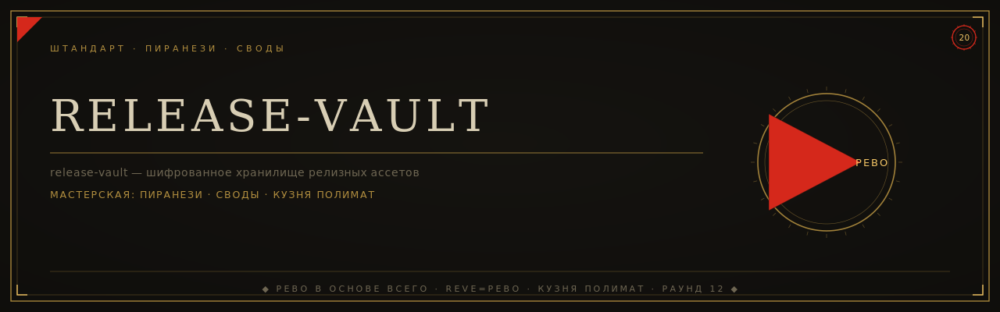
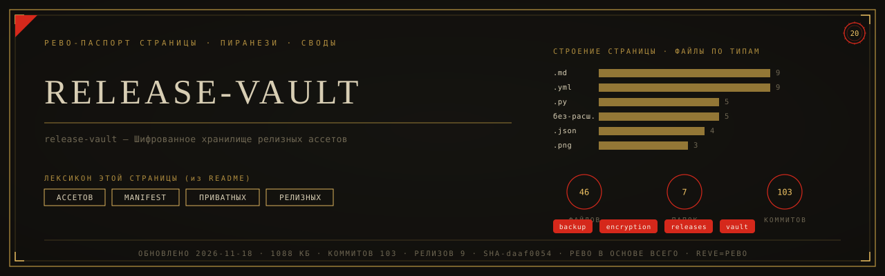

<div align="center">

<a href="https://github.com/rtynbirf/release-vault"></a>

</div>

<!--ФОРЖ:МУЗА:НАЧАЛО-->
<div align="center">
  
  <br/>
  
</div>
<!--ФОРЖ:МУЗА:КОНЕЦ-->

<!--ФОРЖ:ПАСПОРТ:НАЧАЛО-->
<div align="center">
  
</div>

| ФАЙЛОВ | ПАПОК | КОММИТОВ | ОБНОВЛЕНО | РЕЛИЗОВ |
|---:|---:|---:|---|---:|
| 64 | 9 | 199 | 2026-11-28 | 7 |
<!--ФОРЖ:ПАСПОРТ:КОНЕЦ-->

# release-vault

<div align="center">
  
</div>


# release-vault — Шифрованное хранилище релизных ассетов

<p align="center"></p>


Автономный офсайт-архив релизных ассетов приватных репозиториев `rtynbirf`.
Создан 07.11.2026 в рамках волны «Зелёный Сингуляр» для освобождения
Actions-storage квоты приватных репо (лимит 500 МБ был переполнен ×50).

## Схема
- Каждый ассет зашифрован: **AES-256-CBC, PBKDF2-SHA1, 600 000 итераций** (openssl enc).
- Имена файлов нейтрализованы (`rXaYY.enc`) — публичная сторона не раскрывает содержимое.
- `__MANIFEST.enc` — зашифрованный манифест: исходные имена, размеры, SHA256 оригиналов и шифротекстов, релиз-тег источника.
- `__SHA256SUMS.txt` — хеши шифротекстов (проверка целостности без раскрытия).
- Оригиналы удалены из приватных репо ТОЛЬКО после подтверждённой загрузки шифротекста сюда.

## Восстановление (для владельца, у которого есть ключ)
```bash
# расшифровать ассет
openssl enc -d -aes-256-cbc -pbkdf2 -iter 600000 \
  -in rXaYY.enc -out restored.file -pass file:key.txt
# расшифровать манифест (там исходные имена и SHA256)
openssl enc -d -aes-256-cbc -pbkdf2 -iter 600000 \
  -in <РЕПО>__MANIFEST.enc -out manifest.json -pass file:key.txt
```

Ключ хранится только у владельца. Публичная часть — только шифротексты и их хеши.

## Дозор
- `vault-integrity` — машинная сверка шифротекстов: каждая строка `__SHA256SUMS.txt`
  обязана иметь живой ассет, выборочные sha256 сходятся. Расшифровок нет.
- `assets-watchdog` (волна ×4, issue #4) — страж релизных ассетов исходных реп:
  манифесты (`MANIFEST.txt` и родня) против живых релизов — число ассетов,
  размеры, состояния, нулевые файлы (md5 пустого входа `d41d8cd9…`), выборочные
  sha256 «лёгких» частей с ротацией по неделе. Нарушение → append-only авто-issue.
  Конфиг: `assets-watchdog.config.json`; смотрятся публичные репы.

## Что лежит

- `import/branches-2026-11-08/` — шифротексты релизных ассетов, вынесенных из приватных репо 08.11.2026, с их `__SHA256SUMS.txt`.
- `wave3/` — отчёт покрытия и скрипты пломбы волны-3 (`coverage_report.py`, `seal_manifest.py`), «ЖУРНАЛ-ПЛОМБ» и сертификат копии.
- `assets-watchdog.config.json` — конфиг стража ассетов исходных реп.

## Дом

- Ядро дома — [polymath-core](https://github.com/rtynbirf/polymath-core); живой реестр аккаунта — [index](https://github.com/rtynbirf/index).
- Лицензия — MIT ([LICENSE](LICENSE)).

<!--ФОРЖ:ПОДВАЛ-->
---

<div align="center">
  <sub>◆ картина и штандарт — ручная ковка <a href="https://github.com/rtynbirf">КУЗНИ ПОЛИМАТ</a> · ЧЕЛОВЕК=АККАУНТ=PID1 ◆</sub>
</div>
